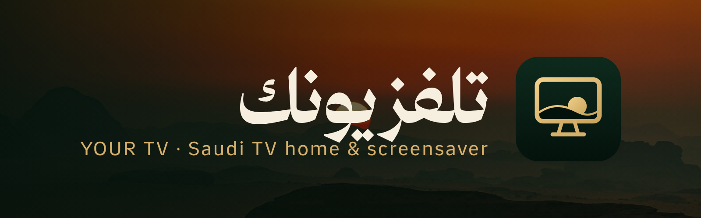

<p align="center"></p>

<h1 align="center">تلفزيونك · Your TV</h1>

<p align="center" dir="rtl">واجهة رئيسية عربية وشاشة توقف سعودية لتلفزيونات Android TV و Google TV، مع أدوات لتسريع التلفزيون وتنظيفه.</p>

<p align="center">An Arabic home screen and a Saudi screensaver for Android TV / Google TV, plus tools to make the TV fast and clean.</p>

| | | |
|---|---|---|
| **شاشة تلفزيونك** · screensaver | Clock, Hijri date, prayer times and iqama, Ramadan, your teams' matches, weather, markets, new episodes — over Saudi landscapes | `tvsaver.apk` |
| **تلفزيونك** · home screen | Clean Arabic launcher: favourites row you edit from the remote (5–10 apps), all apps, inputs, Wi-Fi, settings | `tvhome.apk` |
| **Optimize** | Back up, rate and disable bloat reversibly (AirPlay, casting and voice always kept), speed tweaks, safe launcher switch | `optimize/` |

**Download:** [releases/apk-latest](https://github.com/tshi-dev/TV-ScreenSaver/releases/tag/apk-latest) · **Set up a TV:** [docs/TV-SETUP-PROMPT.md](docs/TV-SETUP-PROMPT.md) · **Photo credits:** [PHOTO-CREDITS.md](PHOTO-CREDITS.md)

## Layout

```
src/template.html          the page itself (HTML/CSS/JS) — edit this
assets/fonts/              Thmanyah woff2 weights (Light, Regular, Medium, Display Bold)
assets/backgrounds/        5 bundled Unsplash photos (offline fallback); the hosted set is in photos/ + backgrounds.json (credit, brightness)
build.py                   inlines fonts and photos -> dist/ksa-dashboard.html
dist/ksa-dashboard.html    the built file to copy to the TV / APK assets
docs/RECREATE-PROMPT.md    the full design + behaviour spec
```

## Build

```sh
python3 build.py
```

No dependencies. Open `dist/ksa-dashboard.html` in any browser; press `F` for fullscreen.

## City

The page reads its config from the URL fragment (works on `file://` and in an Android WebView):

```
ksa-dashboard.html#city=جدة&lat=21.5433&lon=39.1728&tz=Asia/Riyadh&teams=136013,136137&week=1
```

Defaults to Riyadh. `teams` is up to 10 TheSportsDB team ids in priority order (default Al-Hilal 136013 and the Saudi national team 136137). Every team with a result in the last 24h or a fixture this week gets a slot; the panel shows two at a time and turns the page every 15 s. `week=0` hides the new-shows card. Team ids, prayer method and keys are in the `CONFIG` object at the top of the script.

## Data sources (free, no keys)

Aladhan (prayer, Umm al-Qura), Open-Meteo (weather), Yahoo chart API via allorigins (TASI, S&P 500), CoinGecko (Bitcoin), TVMaze (premieres), TheSportsDB (fixtures). Every fetch fails soft: without network the clock, dates, Ramadan countdown, prayer countdown and known fixture still render.

## Android app

`android/` is the TV app (package `com.abdullah.tvsaver`). Every push to `master` builds it in GitHub Actions; the APK is always at
**Releases → `apk-latest` → `tvsaver.apk`**.

- **Screensaver**: `ScreenDream` is a system dream. Choose it in the TV's screensaver settings, or over adb:
  `adb shell settings put secure screensaver_components com.abdullah.tvsaver/.ScreenDream`
- **Settings** (opening the app): city — 194 Saudi cities and towns grouped by the 13 regions
  (`android/.../Cities.java`, generated by `tools/gen_cities.py` from GeoNames) plus an online search for any place
  in the Kingdom — team 1 and team 2 (presets, browse the Saudi and major foreign leagues, search any club or
  national team worldwide on TheSportsDB, or none),
  show genres, languages, shows picked one by one (TVMaze search), minimum rating, auto-update, preview.
- **Auto-update**: every 6 hours the app downloads `dist/ksa-dashboard.html` from this repo's `master`, checks it
  is a complete page and uses it instead of the copy built into the APK. Screen changes reach the TV without reinstalling.
  This needs the repo to stay public.
- **After a power cycle** (TCL): the app registers for every boot broadcast and keeps a persisted background job,
  which brings its process back after a reboot without opening it. If the first screensaver still fails on your TV,
  open the app once — the TV's firmware may block the boot start for apps outside its auto-start list.
- Builds are signed with `android/tvsaver.keystore` (password `tvsaver`) so each one installs over the last.
  The very first install has to replace an APK signed with a different key: uninstall the old app first.

Local build (needs the Android SDK): `python3 build.py && gradle -p android assembleRelease`.
